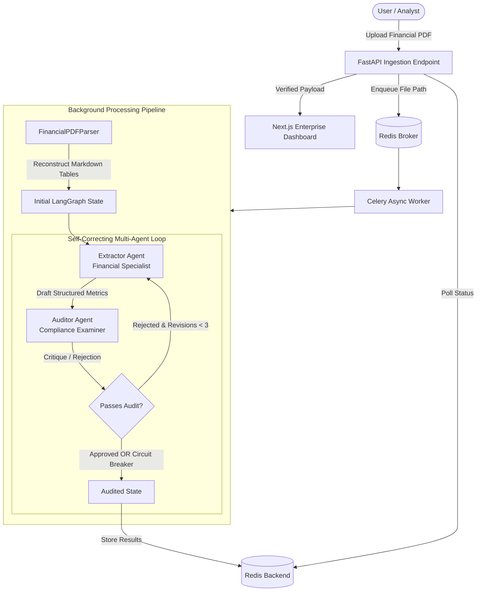

# DocuQuant AI 🛡️📊

> **Enterprise Financial PDF Metric Extraction & Self-Correcting Multi-Agent Audit Engine**

DocuQuant AI is an autonomous, production-grade intelligence pipeline designed to ingest complex financial disclosures (SEC 10-K, 10-Q filings, quarterly earnings, balance sheets), convert intricate tabular layouts into structured Markdown, and execute a self-correcting multi-agent validation loop to guarantee zero-hallucination metric extraction with verbatim citations.

---

## ⚡ Key Capabilities

- **Layout-Preserving PDF Parsing**: Converts complex multi-column financial tables and footnotes into clean GitHub-flavored Markdown using `pdfplumber` and `pypdf`.
- **Self-Correcting Multi-Agent Loop**: Powered by **LangGraph**, an **Extractor Specialist** extracts metrics while an independent **Compliance Auditor** rigorously verifies quotes against raw source text.
- **Circuit-Breaker Protected**: Automatically caps re-extraction attempts at a configurable maximum (default: 3) to prevent runaway LLM execution.
- **Asynchronous Scalability**: Offloads heavy parsing and LLM operations to **Celery** workers backed by **Redis**, providing real-time state polling (`PARSING_DOCUMENT` → `AI_EXTRACTION_AND_AUDIT` → `SUCCESS`).
- **Verbatim Evidence Citations**: Every financial metric links directly to its source quote, providing full traceability for compliance audits.
- **Interactive Modern UI**: Built with **Next.js 16**, **React 19**, and **Tailwind CSS 4**, featuring real-time polling progress, category filters, CSV/JSON export, and one-click demo presets.

---

## 🏗️ Architecture & Agent Workflow



---

## 🗂️ Project Structure

```text
docuquant-ai/
├── docker-compose.yml              # Production orchestration (Redis, FastAPI, Celery, Next.js)
├── README.md                       # Comprehensive system documentation
├── .gitignore                      # Environment, artifact, and dependency exclusions
│
├── backend/                        # FastAPI & Celery Python Backend
│   ├── Dockerfile                  # Multi-stage Python 3.11 container definition
│   ├── requirements.txt            # Constrained enterprise dependencies
│   ├── .env.example                # Sample environment configurations
│   ├── app/
│   │   ├── main.py                 # FastAPI application, CORS, lifespan, and root routers
│   │   ├── core/
│   │   │   ├── config.py           # Pydantic Settings V2 configuration & path resolvers
│   │   │   ├── celery_app.py       # Celery instance & broker configuration
│   │   │   └── logging.py          # Structured application logger
│   │   ├── agents/
│   │   │   ├── schemas.py          # Pydantic schemas (ExtractionReport, FinancialMetric, AuditResult)
│   │   │   ├── state.py            # LangGraph TypedDict state definition
│   │   │   ├── nodes.py            # Extractor & Auditor agent node functions
│   │   │   └── graph.py            # StateGraph builder with circuit breaker logic
│   │   ├── api/
│   │   │   └── v1/
│   │   │       ├── api.py          # Master V1 router aggregation
│   │   │       └── endpoints/
│   │   │           ├── extraction.py # POST /extract, GET /status/{id}, GET /sample
│   │   │           └── health.py   # GET /health with Redis TCP socket probe
│   │   └── services/
│   │       ├── parser.py           # FinancialPDFParser table & layout extractor
│   │       └── tasks.py            # Celery worker background tasks & file cleanup
│   └── tests/
│       ├── test_parser.py          # Unit tests for markdown conversion & layout cleaning
│       ├── test_agents.py          # Unit tests for agent schemas & circuit breaker
│       └── test_api.py             # Integration tests for health & endpoints
│
└── frontend/                       # Next.js 16 & React 19 Frontend
    ├── Dockerfile                  # Multi-stage Node 20 container definition
    ├── package.json                # Modern frontend dependencies
    ├── tsconfig.json               # Strict TypeScript configuration
    └── src/
        ├── app/
        │   ├── layout.tsx          # Dark-mode enterprise layout with ambient glow
        │   ├── page.tsx            # Main dashboard: dropzone, stepper, metrics table
        │   └── globals.css         # Custom scrollbars, glassmorphism, keyframe glow
        ├── components/
        │   ├── Header.tsx          # Brand header with live worker status indicator
        │   ├── DocumentUploader.tsx# Drag-and-drop PDF dropzone with demo presets
        │   ├── ProcessingStepper.tsx # Real-time chronological execution timeline
        │   ├── AuditSummaryCard.tsx# Executive KPI scorecard with export actions
        │   ├── MetricsTable.tsx    # Category-filtered metric table with quote citation
        │   ├── RiskFactorsCard.tsx # Categorized risk disclosure cards
        │   └── RawJsonModal.tsx    # Syntax-highlighted state inspection modal
        ├── hooks/
        │   └── useExtraction.ts    # Polling hook with realistic company demo presets
        ├── lib/
        │   ├── api.ts              # Axios API client with resilient endpoints
        │   └── utils.ts            # Formatting, CSV export, and risk classification
        └── types/
            └── index.ts            # Complete TypeScript domain contracts
```

---

## 🚀 Quick Start

### Option 1: Docker Compose (Recommended)

1. **Clone the repository and prepare your environment:**
   ```bash
   cp backend/.env.example backend/.env
   ```
   Add your `GOOGLE_API_KEY` in `backend/.env`.

2. **Launch all services:**
   ```bash
   docker-compose up --build
   ```

3. **Access the application:**
   - **Frontend Dashboard**: [http://localhost:3000](http://localhost:3000)
   - **Interactive API Docs (Swagger)**: [http://localhost:8000/docs](http://localhost:8000/docs)
   - **API Health Probe**: [http://localhost:8000/health](http://localhost:8000/health)

---

### Option 2: Local Development

#### 1. Start Redis
```bash
docker run -d --name docuquant_redis -p 6379:6379 redis:7-alpine
```

#### 2. Backend Setup
```bash
cd backend
python -m venv venv
# On Windows:
.\venv\Scripts\activate
# On Linux/macOS:
source venv/bin/activate

pip install -r requirements.txt

# Run FastAPI server
uvicorn app.main:app --reload --port 8000

# In a separate terminal, run Celery worker:
celery -A app.core.celery_app.celery_app worker --loglevel=info
```

#### 3. Frontend Setup
```bash
cd frontend
npm install
npm run dev
```
Open [http://localhost:3000](http://localhost:3000) in your browser.

---

## 🧪 Testing & Code Quality

### Backend Test Suite
The backend includes unit and integration tests covering parser markdown generation, agent schemas, circuit breaker state transitions, and API endpoints:
```bash
cd backend
pytest -v
```

### Frontend Code Quality
Strict ESLint and TypeScript checks ensure zero unused variables and strict type safety:
```bash
cd frontend
npm run lint
npx tsc --noEmit --incremental false
```

---

## 🔒 Security & Best Practices

- **Sandboxed Uploads**: Uploaded documents are saved to a deterministic, configured path and removed in a guaranteed `finally` block upon task completion or failure.
- **Strict Size & Format Validation**: Enforces PDF MIME/extension validation and restricts file sizes to 50MB by default.
- **Config Management**: Uses Pydantic Settings V2 for typed environment variables and validation.
- **Circuit Breaker**: Capped agent cycles prevent runaway LLM costs if a low-quality PDF fails audit criteria.

---

## 📄 License
MIT License. © 2026 DocuQuant AI.

